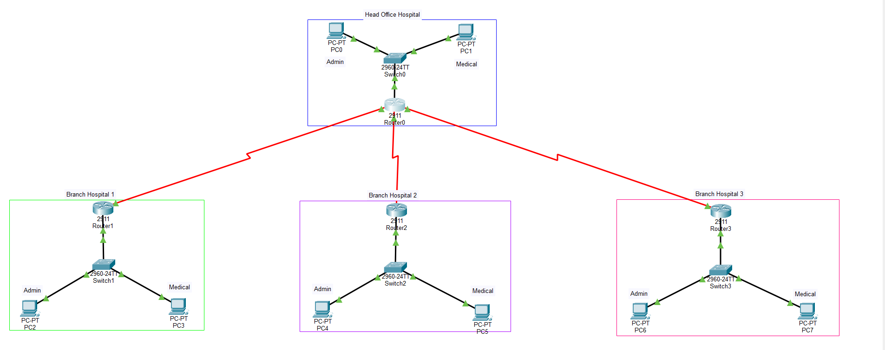
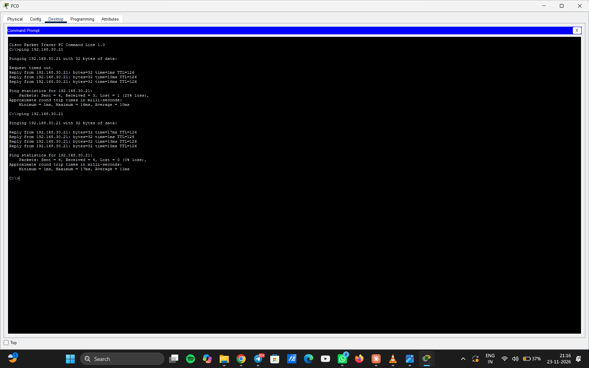
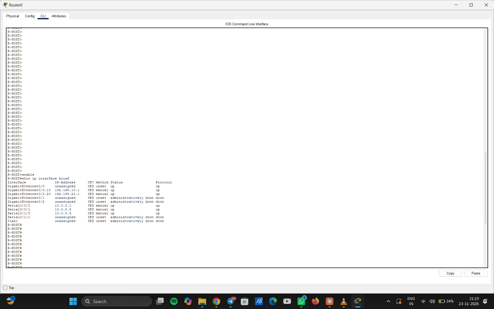
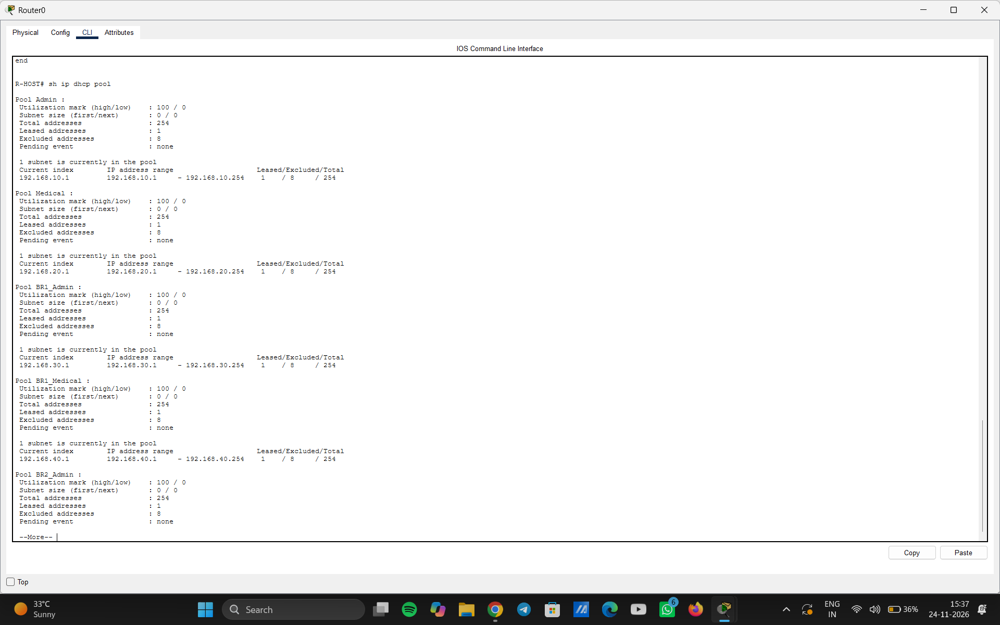
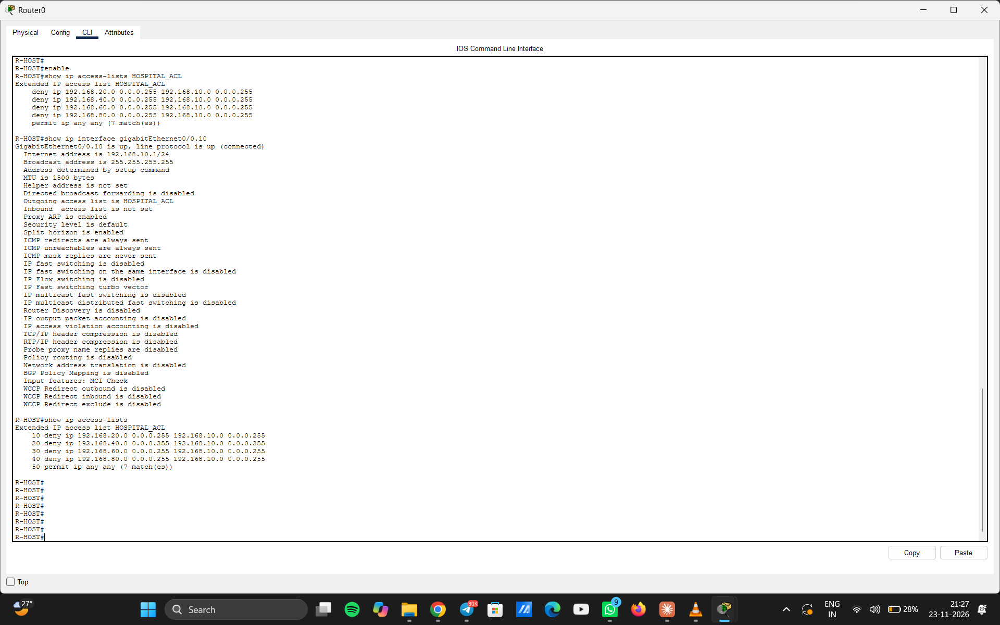
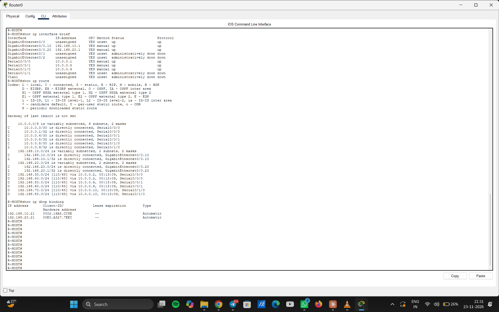

# Hospital Network -- Multi-Branch Network Infrastructure

## Overview

Designed and simulated a hub-and-spoke hospital network connecting a Head Office and three branch hospitals using Cisco Packet Tracer.

The network implements VLAN segmentation for Admin (VLAN 10) and Medical (VLAN 20), centralized DHCP using Router0, DHCP Relay using `ip helper-address`, OSPF dynamic routing (Area 0), and Extended ACLs to control traffic between specified networks.

## Project Objectives

- Design a multi-site hospital network connecting one Head Office and three branch hospitals.
- Implement VLAN 10 (Admin) and VLAN 20 (Medical) at all locations.
- Configure inter-VLAN routing using router-on-a-stick.
- Establish serial WAN connectivity between the Head Office and branch routers.
- Implement OSPF dynamic routing for communication between remote networks.
- Configure centralized DHCP on the Head Office router.
- Configure DHCP Relay on branch routers using `ip helper-address`.
- Implement Extended ACLs to restrict Medical network access to the Head Office Admin subnet.
- Verify network connectivity, DHCP address assignment, and ACL functionality.

## Network Topology

The network consists of four hospital locations.

### 1. Head Office Hospital (Central Hub)
- 1 Cisco 2911 Router (Router0)
- 1 Cisco 2960 Switch (Switch0)
- 1 Admin PC
- 1 Medical PC
- Centralized DHCP Server

### 2. Branch Hospital 1
- 1 Cisco 2911 Router (Router1)
- 1 Cisco 2960 Switch (Switch1)
- 1 Admin PC
- 1 Medical PC
- DHCP Relay Agent

### 3. Branch Hospital 2
- 1 Cisco 2911 Router (Router2)
- 1 Cisco 2960 Switch (Switch2)
- 1 Admin PC
- 1 Medical PC
- DHCP Relay Agent

### 4. Branch Hospital 3
- 1 Cisco 2911 Router (Router3)
- 1 Cisco 2960 Switch (Switch3)
- 1 Admin PC
- 1 Medical PC
- DHCP Relay Agent

## Network Architecture

The network follows a hub-and-spoke topology, with the Head Office acting as the central hub connecting three branch hospitals through point-to-point serial WAN links.

Each hospital has:
- One router
- One local switch
- Admin and Medical departments
- Separate VLANs for departmental traffic

The Head Office manages centralized DHCP services, while branch routers forward DHCP requests to the central server.

## VLAN Segmentation

| VLAN ID | VLAN Name | Department |
|---|---|---|
| 10 | ADMIN | Administration |
| 20 | MEDICAL | Medical |

VLANs logically separate Admin and Medical devices at each hospital.

- Access ports connect PCs to their respective VLANs.
- Trunk links carry VLAN traffic between switches and routers.
- Router subinterfaces provide inter-VLAN routing.

## IP Addressing Plan

| Hospital | VLAN | Department | Network | Gateway |
|---|---:|---|---|---|
| Head Office | 10 | Admin | 192.168.10.0/24 | 192.168.10.1 |
| Head Office | 20 | Medical | 192.168.20.0/24 | 192.168.20.1 |
| Branch 1 | 10 | Admin | 192.168.30.0/24 | 192.168.30.1 |
| Branch 1 | 20 | Medical | 192.168.40.0/24 | 192.168.40.1 |
| Branch 2 | 10 | Admin | 192.168.50.0/24 | 192.168.50.1 |
| Branch 2 | 20 | Medical | 192.168.60.0/24 | 192.168.60.1 |
| Branch 3 | 10 | Admin | 192.168.70.0/24 | 192.168.70.1 |
| Branch 3 | 20 | Medical | 192.168.80.0/24 | 192.168.80.1 |

Subnet Mask: `255.255.255.0`

## WAN Connectivity

Connected the Head Office router to all three branch routers using point-to-point serial WAN links.

| WAN Link | Network | Head Office IP | Branch IP |
|---|---|---|---|
| Head Office – Branch 1 | 10.0.0.0/30 | 10.0.0.1 | 10.0.0.2 |
| Head Office – Branch 2 | 10.0.0.4/30 | 10.0.0.5 | 10.0.0.6 |
| Head Office – Branch 3 | 10.0.0.8/30 | 10.0.0.9 | 10.0.0.10 |

WAN Subnet Mask: `255.255.255.252`

## Network Configuration

### 1. VLAN Configuration and Trunking
- Created VLAN 10 (Admin) and VLAN 20 (Medical) on all four switches.
- Assigned end-device ports to the appropriate VLANs.
- Configured trunk links to carry VLAN traffic between switches and routers.
- Used IEEE 802.1Q VLAN tagging.

### 2. Inter-VLAN Routing

Configured router-on-a-stick using router subinterfaces and 802.1Q trunking to enable communication between VLANs through their respective gateways.

### 3. WAN Connectivity and OSPF Routing

- Established serial WAN links between the Head Office and three branch routers.
- Configured IP addressing using /30 subnetting.
- Implemented OSPF process 1 using Area 0.
- Configured router IDs and advertised LAN and WAN networks.
- Enabled automatic route exchange between remote hospital networks.

### 4. Centralized DHCP Configuration

Configured Router0 (Head Office) as the central DHCP server managing all eight departmental DHCP pools across the four hospital locations.

**DHCP Architecture:**

| Router | Role | DHCP Configuration |
|---|---|---|
| Router0 | Head Office | Central DHCP server with 8 pools |
| Router1 | Branch 1 | DHCP Relay |
| Router2 | Branch 2 | DHCP Relay |
| Router3 | Branch 3 | DHCP Relay |

**Eight DHCP Pools:**

| DHCP Pool | Network | Default Gateway |
|---|---|---|
| HO_ADMIN | 192.168.10.0/24 | 192.168.10.1 |
| HO_MEDICAL | 192.168.20.0/24 | 192.168.20.1 |
| BR1_ADMIN | 192.168.30.0/24 | 192.168.30.1 |
| BR1_MEDICAL | 192.168.40.0/24 | 192.168.40.1 |
| BR2_ADMIN | 192.168.50.0/24 | 192.168.50.1 |
| BR2_MEDICAL | 192.168.60.0/24 | 192.168.60.1 |
| BR3_ADMIN | 192.168.70.0/24 | 192.168.70.1 |
| BR3_MEDICAL | 192.168.80.0/24 | 192.168.80.1 |

**DHCP Server Configuration:**
- Configured all eight DHCP pools on Router0.
- Excluded addresses `.1` to `.20` in each subnet for gateways and reserved infrastructure.
- Configured subnet masks and default gateways for each pool.
- Configured DNS server information where required.
- DHCP addresses are assigned from `.21` onward.

**DHCP Relay Configuration:**

Configured `ip helper-address 192.168.10.1` on both VLAN subinterfaces of each branch router.

Example:

```cisco
interface g0/0.10
ip helper-address 192.168.10.1

interface g0/0.20
ip helper-address 192.168.10.1
```

The same relay configuration is applied on Router1, Router2, and Router3.

**How Centralized DHCP Works:**

1. A branch PC sends a DHCP Discover broadcast.
2. Its branch router receives the DHCP request.
3. The router forwards the request to Router0 using `ip helper-address`.
4. Router0 identifies the requesting subnet and selects the appropriate DHCP pool.
5. Router0 provides the DHCP response through the relay agent.
6. The PC receives its IP address, subnet mask, and default gateway automatically.

This allows one central DHCP server to manage IP address allocation across all four hospital locations.

### 5. Extended ACL Configuration

Configured a named Extended ACL called `HOSPITAL_ACL` on the Head Office router.

**Security Policy:**
- Blocks IP traffic from Medical VLAN networks to the Head Office Admin subnet (`192.168.10.0/24`).
- Permits other IP traffic through the final `permit ip any any` rule, unless restricted by another policy.

**Restricted Medical Networks:**

| Hospital | Medical Network |
|---|---|
| Head Office | 192.168.20.0/24 |
| Branch 1 | 192.168.40.0/24 |
| Branch 2 | 192.168.60.0/24 |
| Branch 3 | 192.168.80.0/24 |

**ACL Placement:**
- Configured on Head Office Router0.
- Applied outbound on subinterface `G0/0.10`.

The ACL provides traffic filtering to protect the Head Office Admin subnet from the specified Medical networks.

Note: This is a stateless ACL. It does not track established connections and may also block return traffic for Admin-initiated connections to Medical networks.

## Connectivity Testing and Verification

The following Cisco IOS commands were used to verify network configuration and operation.

### Router Interface Verification

```cisco
show ip interface brief
```

### VLAN and Trunk Verification

```cisco
show vlan brief
show interfaces trunk
```

### OSPF Verification

```cisco
show ip ospf neighbor
show ip route
```

### Centralized DHCP Verification

On Router0:

```cisco
show ip dhcp pool
show ip dhcp binding
show running-config | section dhcp
```

On branch routers:

```cisco
show running-config
```

Verify the `ip helper-address 192.168.10.1` configuration on both VLAN subinterfaces.

### Extended ACL Verification

```cisco
show ip access-lists HOSPITAL_ACL
show ip interface g0/0.10
```

### PC Connectivity Testing

On PCs, use:

```cmd
ipconfig
ping <destination-IP-address>
```

Expected results:
- PCs receive IP addresses automatically from Router0.
- Branch PCs receive addresses from their respective DHCP pools through DHCP Relay.
- OSPF establishes routing between hospital locations.
- Admin-to-Admin communication is permitted when routing and ACL policies allow it.
- Medical-to-Head Office Admin traffic is blocked by the configured Extended ACL.

## Screenshots

### 1. Complete Hospital Network Topology



### 2. Connectivity Test



### 3. Router Interface Status



### 4. Centralized DHCP Configuration



### 5. Extended ACL Configuration



### 6. IP Addressing Table



## Devices Used

- 4 Cisco 2911 Routers
- 4 Cisco 2960 Switches
- 8 PCs
- Serial WAN connections
- Ethernet connections

## Technologies and Skills Demonstrated

- Cisco Packet Tracer
- Multi-Branch Network Design
- Hub-and-Spoke Topology
- VLAN 10 – Admin
- VLAN 20 – Medical
- Router-on-a-Stick
- IEEE 802.1Q Trunking
- IPv4 Addressing and Subnetting
- Centralized DHCP
- DHCP Relay (`ip helper-address`)
- OSPF Dynamic Routing (Area 0)
- Serial WAN Connectivity
- Extended Access Control Lists (ACLs)
- ICMP Connectivity Testing
- Network Troubleshooting

## Project Purpose

This project was developed as a hands-on networking project to gain practical experience in designing, configuring, and troubleshooting a multi-branch hospital network.

It demonstrates centralized IP address management, VLAN-based departmental segmentation, dynamic routing, WAN connectivity, and traffic filtering using Extended ACLs.

This is an educational Cisco Packet Tracer simulation. A production hospital network would require additional security controls, stateful firewalls, redundancy, monitoring, authentication, and protection of sensitive healthcare information.

## Author

Computer Science and Engineering graduate interested in Networking, Network Administration, Cloud Infrastructure, and System Administration.
